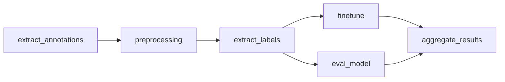

# Pioneer Offline Finetuning

Code for fine-tuning and evaluation of seizure-detection models on continuous EEG recordings from epilepsy monitoring unit (EMU). Prospectively collected patient self-reported seizures or annotations to LLM prompted alerts were used as fine-tuning labels. Models include **[SPaRCNet](https://doi.org/10.1212/WNL.0000000000207127)** for scalp EEG and **[WaveNet](http://biorxiv.org/lookup/doi/10.1101/2022.10.24.513577)** and **ONCET** (unpublished work) for intracranial EEG.

This is the research code accompanying our preprint:

> **An Implantable Device that Converses with Patients and Learns to Co-Manage Epilepsy.**
> medRxiv (2026). [https://doi.org/10.64898/2026.01.26.26344234](https://doi.org/10.64898/2026.01.26.26344234)

See also the companion repositories: [Pioneer Chat Interface](https://github.com/penn-cnt/Pioneer-Chat-Release) (patient-facing chat UI) and [Pioneer Databricks](https://github.com/penn-cnt/Pioneer-Databricks-Release) (streaming feature pipeline).

## Disclaimer

This software is provided for research purposes only. It is **not** a medical device and must not be used for clinical decision-making outside of an approved research protocol.

## Overview




1. Extract clinician labelled ground truth seizures and patient self-reported annotations from raw EMU recordings. Human-AI platform annotations need to be extracted separately.
2. Preprocess continuous EDF clips into SQLite-backed tables.
3. Build ground truth and fine-tuning labels time-aligned with model predictions.
4. Evaluate a fixed baseline model
5. Finetune and evaluate fine-tuned models.
6. Aggregate results and generate figures for manuscript.


## Repository structure

```
pioneer_finetune/
├── 00_extract_annotations.py   # Annotation export & trending plots
├── 01_preprocessing.py           # EDF → preprocessed clips / SQLite
├── 02_extract_labels.py          # Label intervals for training
├── 03_eval_model.py              # Baseline / checkpoint evaluation
├── 04_finetune.py                # Sequential finetuning + inline eval
├── 05_aggregate_results.ipynb    # Cross-patient result aggregation
└── funcs/
    ├── context.py                # Shared CLI context (paths, batches, MLflow)
    ├── sparcnet_funcs_update.py  # SPaRCNet finetune / predict / metrics (scalp)
    ├── wvnt_funcs.py             # WaveNet pipeline (intracranial)
    ├── oncet_funcs.py            # ONCET pipeline (intracranial)
    ├── feat_funcs.py             # Feature helpers (aligned with Databricks)
    ├── metric_funcs.py           # Classification metrics
    └── utils.py                  # EEG I/O, filtering, SQLite helpers
```


### Models

Model files and artifacts need to be download separately.

- SPaRCNet: [https://github.com/bdsp-core/IIIC-SPaRCNet.git](https://github.com/bdsp-core/IIIC-SPaRCNet.git)
- WaveNet & ONCET: [https://github.com/wojemann/DynaSD.git](https://github.com/wojemann/DynaSD.git)
- Model functions need to be put under `funcs/SPaRCNet` , `funcs/WVNT` , `funcs/ONCET`
- Pretrained model need to be put under `models/base_model.pt` , `models/wvnt_base_model.pt, models/oncet_base_model.pt`


## Data

- Raw EEG Data and intermediate seizure probability data needed to replicate manuscript results are released on Pennsieve under [https://doi.org/10.26275/ju7h-bo8u](https://doi.org/10.26275/ju7h-bo8u)
- Download contents in`raw_data`  from the pennsieve dataset and store under root

```
pioneer_finetune/
├── edf/
├── annots/
└── participants.tsv
```


## Requirements

Python 3.10+ recommended. 

Install example:

```bash
pip install -r requirements.txt
```


## Usage

Run from the repository root. 

```bash
# 1. Annotations
python 00_extract_annotations.py -p all
python 00_extract_annotations.py -p PennEPI*****
```

This step work only on EDF files with annotations embeded. This step should be skipped when using released EDFs as products of this step are released as events.

```bash
# 2. Preprocessing
python 01_preprocessing.py -p PennEPI*****

# 3. Labels
python 02_extract_labels.py -p PennEPI*****

# 4. Baseline evaluation
python 03_eval_model.py -m base_model -p PennEPI*****

# 5. Finetuning
python 04_finetune.py -m base_model -p PennEPI***** -l patient -uf --unfreeze_stage 1 --setting test
python 04_finetune.py -m base_model -p PennEPI***** -l databricks -uf --unfreeze_stage 1 --setting test

# 6. Aggregate results
jupyter notebook 05_aggregate_results.ipynb
```

Common flags:

- `-p` patient list, separated by comma
- `-m` model names to evaluate/fine-tune
- `-f` / `--force` — rerun even if outputs exist  
- `--setting SUFFIX` — experiment name suffix  
- `-l` fine-tuning label to use, `patient` , `tech`, or `databricks`
- `-u` whether do gradual unfreezing
- `--unfreeze_stage` from which layer to start unfreeze

See `python 04_finetune.py -h` for the full argument list.

## Citation

If you use this code or build on it, please cite the preprint:

```bibtex
@article{pioneer2026,
  title   = {An Implantable Device that Converses with Patients and Learns to Co-Manage Epilepsy},
  author  = {Goldblum, Zack and Shi, Haoer and Xu, Zhongchuan and Ojemann, William K. S. and Aguila, Carlos A. and Long, Kevin and Xie, Kevin and Nix, Kerry C. and Walsh, Katie and Chang, Ellie and Lavelle, Sarah and Bach, Brandon and Davis, Kathryn A. and Sinha, Nishant and Hammer, Lauren H. and Conrad, Erin C. and Litt, Brian},
  journal = {medRxiv},
  year    = {2026},
  doi     = {10.64898/2026.01.26.26344234},
  url     = {https://doi.org/10.64898/2026.01.26.26344234}
}
```


## License

This software is released under the Penn Academic Software License Agreement, which permits internal research and non-commercial use only. See [LICENSE](LICENSE).
